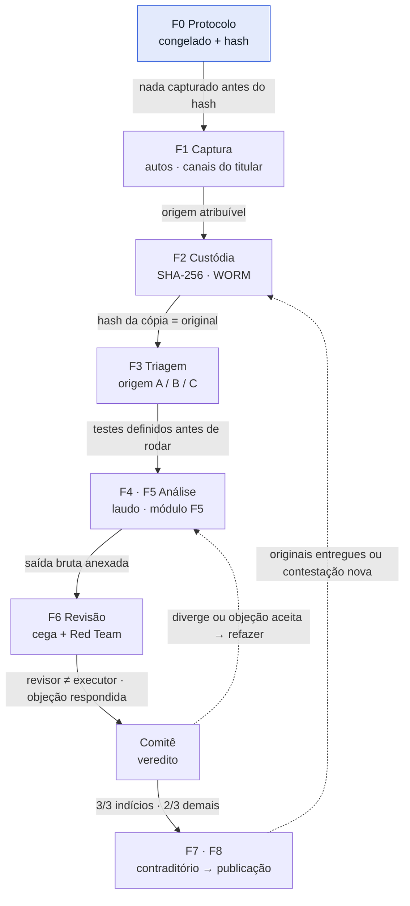
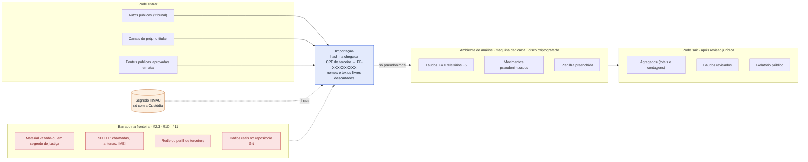

# Verificação fiscal e bancária — frente fiscal

Ferramentas e método para verificar se os documentos fiscais e bancários que o senador Flávio Bolsonaro tornar públicos são **íntegros, autênticos, coerentes e completos**, sem expor terceiros e sem usar material obtido de forma ilegítima.

> **Este repositório guarda só método, código, modelos e exemplos fictícios. Nunca dados reais.**
> Extratos, arquivos SIMBA, declarações, PDFs dos autos, planilhas preenchidas, saídas dos scripts e o `segredo.key` ficam no armazenamento da Custódia. O histórico do Git guarda tudo para sempre: um arquivo apagado depois continua recuperável.

Regras completas: [`Protocolo_Verificacao_v2.md`](Protocolo_Verificacao_v2.md) (rascunho, ainda não congelado).
Visão geral em PDF: [`docs/2026-10-22_Verificacao_Frente_Fiscal.pdf`](docs/2026-10-22_Verificacao_Frente_Fiscal.pdf).

---

## O que o método responde

| | Pergunta | Unidade | Ferramenta |
|---|---|---|---|
| **P1** | Integridade: o arquivo foi alterado depois de gerado? | arquivo | `laudo_f4.py` |
| **P2** | Autenticidade: veio do emissor que alega? | arquivo | `laudo_f4.py`, validador do ITI, códigos de autenticação |
| **P3** | Coerência: bate internamente, entre bases e com fontes públicas? | arquivo e conjunto | `modulo_f5.py`, [guia de fontes](Fontes_Publicas_Cruzamento.md) |
| **P4** | Completude: o que foi entregue cobre tudo o que foi autorizado? | conjunto | `modulo_f5.py` (testes C1 a C6) |

O método **não** responde sobre intenção, culpa ou conduta de ninguém. O relatório descreve evidências; expressões como "omitiu" ou "fraudou" não são usadas.

---

## Fluxo de trabalho

Cada etapa só avança quando a condição escrita na seta é cumprida. As setas tracejadas são os dois retornos: divergência ou objeção aceita manda a análise de volta, e material novo entra de novo pela custódia.



Onde cada etapa deixa prova:

| Etapa | Registro |
|---|---|
| F0 Protocolo | `Protocolo_Verificacao_v2.md`, ata do Comitê, hash publicado |
| F1 Captura | abas **Fontes** e **Custodia** da planilha |
| F2 Custódia | aba **Custodia** (Gate F2) |
| F3 Triagem | classe de origem na **Custodia**, bateria em **Log_Testes** |
| F4 · F5 Análise | laudos e relatórios F5, abas **Divergencias** e **Completude** |
| F6 Revisão | **Log_Testes**, **Red_Team** |
| Comitê | **Atas_Comite**, **Completude_Conjuntos** |
| F7 · F8 | **Contraditorio**, **Painel** ("Pronto para publicar?") |

---

## Fronteira dos dados

A pseudonimização acontece na importação, antes de qualquer analista ver o dado. O segredo que gera os pseudônimos fica só com a Custódia, fora do ambiente de análise.



Fluxograma completo, com a tabela de conformidade (regra → controle → prova): abra [`docs/esquema_verificacao.html`](docs/esquema_verificacao.html) no navegador.

---

## Arquivos

| Arquivo | O que faz | Depende de |
|---|---|---|
| `nucleo.py` | Implementação única de hashes, normalização de CPF/CNPJ, datas e valores, leiaute SIMBA, pseudonimização (T1), classificação B2 e checagens 6.5 com a regra B4 | só a biblioteca padrão |
| `laudo_f4.py` | Perícia de PDF (P1/P2): revisões e diff de texto entre elas, metadados, fontes, imagens, assinatura, comparação com referência | `nucleo.py`; exiftool, qpdf e poppler, se instalados |
| `modulo_f5.py` | Completude (P4) e cruzamento bancário × fiscal (P3) | `nucleo.py` |
| `Controle_Verificacao.xlsx` | Planilha de controle **modelo** (vazia): custódia, testes, divergências, completude, Red Team, atas, contraditório, fontes | — |
| `Protocolo_Verificacao_v2.md` | Protocolo (rascunho) | — |
| `Fontes_Publicas_Cruzamento.md` | Onde consultar cada dado público e como arquivar a consulta | — |
| `exemplos/` | Saídas geradas com dados **fictícios** | — |
| `docs/` | Documento de método em PDF (retrato datado) e o fluxograma em HTML | — |
| `kit_sigilo/` | Leitura geral em pandas (bancário, fiscal, telefônico) | `nucleo.py` |

### Sobre o `kit_sigilo`

**Só a parte SIMBA, via `nucleo.py`, pode ser usada nesta verificação.** Os módulos telefônico (`sittel.py`), de pessoas, de cruzamento de telefones e de linha do tempo estão **fora do protocolo** (§2.3, §10 e regra T6) e não entram no Anexo A. Não rode o kit com dados reais.

<!-- Se a coordenação decidir remover o kit do repositório, apague esta seção e a linha do kit na tabela acima. -->

---

## Como usar

### Requisitos
- Python 3.9 ou mais recente (só biblioteca padrão para `nucleo.py`, `laudo_f4.py` e `modulo_f5.py`).
- Recomendado para o laudo: exiftool, qpdf e poppler. No macOS:
  ```bash
  brew install exiftool qpdf poppler
  ```
  Sem eles, cinco testes do laudo saem como "Inconclusivo".
- `nucleo.py` precisa estar na mesma pasta dos scripts.

### Laudo técnico de um PDF (F4)
Sempre sobre uma **cópia de trabalho**, nunca sobre o original:
```bash
python3 laudo_f4.py COPIA.pdf --id DOC-001 --executor M01 --hash-esperado <sha256 da custódia> --referencia REFERENCIA.pdf
```
Gera em `laudos/DOC-001/`: o laudo em Markdown e JSON, as linhas para a aba Log_Testes, as revisões anteriores do arquivo e as saídas brutas. Se o hash não bater com o da custódia, a análise para.

### Completude e cruzamento (F5)
```bash
# só a Custódia, uma vez; guardar fora do ambiente dos analistas
python3 modulo_f5.py gerar-segredo --arquivo segredo.key

# modelos de entrada: escopo da autorização e IR transcrito dos autos
python3 modulo_f5.py modelos --pasta entradas

# análise
python3 modulo_f5.py analisar --simba autos/simba --entradas entradas --titular-cpf <CPF> --segredo segredo.key --id CONJ-01
```
Gera em `f5/CONJ-01/`: relatório, completude, cruzamentos, lacunas e divergências candidatas (para colar na planilha) e agregados publicáveis. O arquivo `movimentos_pseudonimizados.csv` é material interno e não sai do ambiente de análise.

---

## Regras para quem faz commit

1. **Nunca suba dados.** O [`.gitignore`](.gitignore) cobre os casos comuns (`autos/`, `entradas/`, `fontes/`, `laudos/`, `f5/`, `*.key`, `*.txt`, PDFs fora de `docs/`, cópias da planilha), mas a responsabilidade é de quem faz o commit. Rode `git status` antes.
2. **A planilha no repositório é só o modelo vazio.** Cópias de trabalho levam outro nome (por exemplo `Controle_Verificacao_CONJ-01.xlsx`) e ficam fora.
3. **Mudou um script? Suba a versão** (`VERSAO` no topo do arquivo) e anote no Anexo A do protocolo, com o SHA-256. Os laudos e relatórios registram a versão e o hash de cada script usado.
4. **Mudou uma regra do protocolo depois do congelamento?** É uma nova versão do protocolo, com ata. Não se edita o arquivo congelado.
5. Repositório **privado**, só com membros da frente, todos com **2FA** no GitHub.

---

## Versões

| Componente | Versão |
|---|---|
| Protocolo | 2.0 (rascunho) |
| `nucleo.py` | 1.0 |
| `laudo_f4.py` | 1.2 |
| `modulo_f5.py` | 1.1 |
| Planilha | v2 + aba Fontes |
